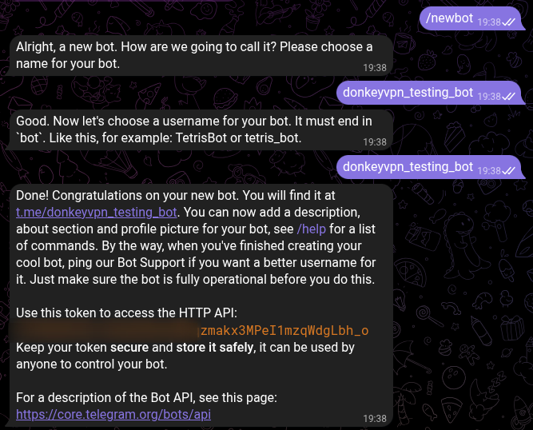
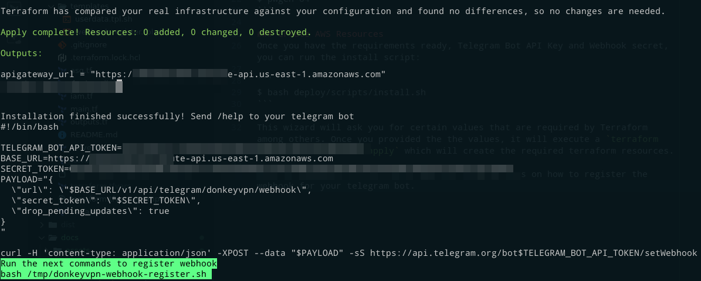

Installation
===

## Requirements
Before running the installation script, make sure you have the following requirements ready:
- Go 1.22+ properly installed.
- Terraform 1.9+ installed.
- Your AWS credentials and profile configured.

## Installation
### Create a Telegram Bot
Follow [Telegram's documentation](https://core.telegram.org/bots/tutorial) on how to create a bot by chatting with [@BotFather](https://t.me/botfather). Once you created your bot, you can obtain the token.



### Generating a Webhook secret
The way TelegramBot sends messages to the DonkeyVPN application is via webhooks (we will see how to configure that part later). But before creating AWS resources, you will need to generate a secure string that will be used as the webhook secret that Telegram will send to DonkeyVPN.

You can use your preferred random string generator, in my case I will use `pwgen`

```
$ pwgen 84
```

### Allowed chat ids
Only the Telegram chats listed in the allowlist can use the bot. Messages from any other chat get a single reply, "⛔ You are not authorized to use this bot. Your chat id is `<chat_id>`.", and nothing else runs. If the list is empty, every chat is rejected.

The allowlist is a comma-separated list of chat ids (e.g. `12345,-100123`) stored in the SSM SecureString parameter `/donkeyvpn/allowedchatids`. Group chat ids are negative. If you list a group, every member of that group can use the bot.

If you don't know your chat id yet:
1. When the wizard asks for `Allowed Telegram chat ids (comma-separated)`, enter `0` as a placeholder.
2. Finish the installation and register the webhook.
3. Send any message to the bot. It replies with your chat id.
4. Replace the value with your chat id (see [Changing the allowed chat ids](#changing-the-allowed-chat-ids)).

### Changing the allowed chat ids
The bot reads `/donkeyvpn/allowedchatids` from SSM when a Lambda container starts, so you can add or remove chats without redeploying:

```
$ aws ssm put-parameter --name /donkeyvpn/allowedchatids --type SecureString --overwrite --value 12345,-100123
```

You can also run `bash deploy/scripts/install.sh wizard` and replace the value when it asks.

The new list is picked up by the next Lambda container that starts. A warm container keeps the list it already loaded, so the change can take a while to reach every request. To apply it right away, force new containers by changing any function setting, for example:

```
$ aws lambda update-function-configuration --function-name donkeyvpn-<environment>-echo-api --description "allowlist updated $(date +%s)"
```

### Create AWS Resources
Once you have the requirements ready, Telegram Bot API Key and Webhook secret, you can run the install script:

```
$ bash deploy/scripts/install.sh
```

This wizard will ask you for certain values that are required by Terraform among others. Once you provided the the values, it will execute a `terraform init` and `terraform apply` which will create the required terraform resources.

Once it finishes, it will give you the instructions on how to register the webhook for your telegram bot.




### Testing Bot
Once the installation script finished creating the resources and you executed the `donkeyvpn-webhook-register.sh ` script, the Telegram Bot should be able to send any message you send to the API Gateway that was created which has a lambda function running DonkeyVPN.

Go to your Telegram client and send the `/help` command to see the available options that you have to operate DonkeyVPN.

Congratulations! Now you can create ephemeral and low cost ephemeral VPN servers.


### Upgrading DonkeyVPN
In order to upgrade to the latest version of DonkeyVPN, clone the repository, fetch the latest changes and run again the `install.sh` script

```
$ bash deploy/scripts/install.sh
```

#### Upgrading to the chat allowlist (BREAKING)
Starting with the chat allowlist, the bot only answers chats listed in the SSM parameter `/donkeyvpn/allowedchatids`. **Create this parameter when you upgrade.** If it's missing, the deploy still succeeds, but the bot rejects every chat (it logs `Could not load allowed chat ids` and replies to each chat with its chat id). Either:

- run the wizard, which asks for `Allowed Telegram chat ids (comma-separated)`:
  ```
  $ bash deploy/scripts/install.sh wizard
  ```
- or create the parameter manually:
  ```
  $ aws ssm put-parameter --name /donkeyvpn/allowedchatids --type SecureString --value 12345
  ```

Then build and apply:

```
$ bash deploy/scripts/install.sh build
$ bash deploy/scripts/install.sh terraform_apply
```

If you don't know your chat id, follow the steps in [Allowed chat ids](#allowed-chat-ids).
